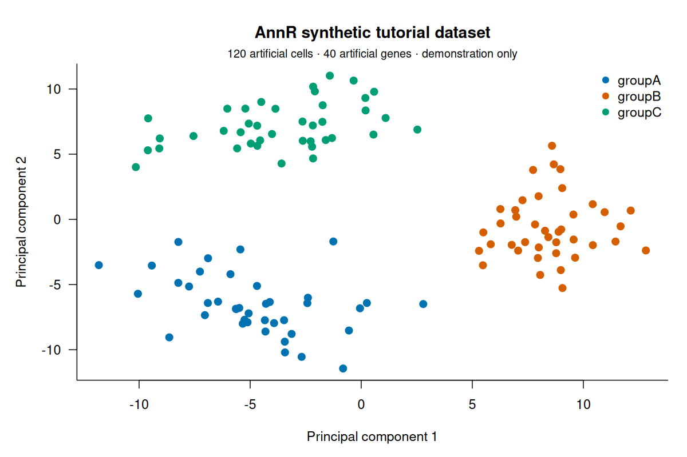

# AnnR: a complete guide to moving single-cell data between R and Python

**Author and maintainer: MD BABU MIA** · AnnR 0.1.0

This tutorial uses the small synthetic dataset bundled with AnnR. It covers
installation, inspection, selective reads, subsetting, writing, conversion,
and verification in Python. No external data download is needed. All values
are artificial; the example demonstrates data interchange rather than a
biological analysis.

## 1. Install AnnR

AnnR needs R >= 4.1, a C++17 compiler, HDF5 >= 1.10.5, and zlib development
files. libdeflate speeds up gzip; libzstd enables built-in Zstandard support.

```sh
# Ubuntu / Debian
sudo apt install build-essential pkg-config libhdf5-dev zlib1g-dev libdeflate-dev libzstd-dev
# macOS, after installing Apple's command-line developer tools
brew install pkg-config hdf5 libdeflate zstd
```

Then, in R:

```r
install.packages("remotes")
remotes::install_github("mdbabumiamssm/AnnR", build_vignettes = FALSE)
library(AnnR)
packageVersion("AnnR")
annr_build_info()
```

A private GitHub repository requires an account with access and a configured
GitHub token. Public access becomes available only after the repository owner
makes the repository public. AnnR is distributed as source; installation
compiles the native engine. The configure script can use Bioconductor's
`Rhdf5lib` when a system HDF5 library cannot be found. Custom installations
can set `ANNR_HDF5_CFLAGS` and `ANNR_HDF5_LIBS` before installation.

For optional conversion support:

```r
install.packages(c("BiocManager", "SeuratObject"))
BiocManager::install("SingleCellExperiment")
```

Windows support uses the HDF5 fallback reader; the parallel direct read path
is disabled there. This release's local validation was performed on Linux;
other platforms need their own successful build and test run.

## 2. Locate and read the example

```r
library(AnnR)
f <- system.file("extdata", "annr_toy.h5ad", package = "AnnR", mustWork = TRUE)
ad <- read_h5ad(f)
ad
dim(ad)                 # 120 cells x 40 genes
head(ad$obs)
head(ad$var)
obs_names(ad)[1:5]
var_names(ad)[1:5]
```

The example contains three simulated cell groups, two artificial batches,
a sparse normalized matrix, a sparse count layer, two principal components,
feature loadings, a demonstration ring graph, and a raw count snapshot.
`inst/extdata/README.md` documents every field. The CSV companions are
available through `system.file("extdata", "toy_counts.csv", package="AnnR")`.

## 3. Understand matrix orientation and meaning

AnnR follows Python AnnData: **cells are rows; genes are columns**.
SingleCellExperiment and Seurat use **genes as rows; cells as columns**.
The conversion functions handle that change.

| Component | Shape | Meaning in this example |
|---|---|---|
| `ad$X` | 120 x 40 | `log1p(counts / total_counts * 10000)` |
| `ad$layers$counts` | 120 x 40 | Simulated counts |
| `ad$obs` | 120 rows | Cell annotations |
| `ad$var` | 40 rows | Feature annotations |
| `ad$obsm$X_pca` | 120 x 2 | PCA scores |
| `ad$varm$PCs` | 40 x 2 | PCA loadings |
| `ad$obsp$connectivities` | 120 x 120 | Demonstration graph |
| `ad$raw$X` | 120 x 40 | Count snapshot |
| `ad$uns` | named list | Provenance and other metadata |

For other datasets, `X` can represent counts, normalized values, residuals,
or another matrix. AnnR does not infer or change that meaning. Identify the
appropriate matrix before choosing a Seurat count or data layer.

## 4. Inspect structure before loading matrices

```r
info <- h5ad_info(f)
head(info)
names(info)
pca <- read_h5ad_elem(f, "obsm/X_pca")
dim(pca)                # 120 x 2
cell_annotations <- read_h5ad_elem(f, "obs")
```

`h5ad_info()` reads HDF5 metadata. `read_h5ad_elem()` loads only the named
element; its matrix orientation remains cells x genes where appropriate.
This is useful for retrieving an embedding from a much larger file.

## 5. Read selected slots

```r
selected <- read_h5ad(
  f, X = FALSE, layers = "counts", obsm = "X_pca",
  varm = FALSE, obsp = FALSE, varp = FALSE, uns = FALSE, raw = FALSE
)
stopifnot(is.null(selected$X), identical(names(selected$layers), "counts"))
```

Selection controls which elements are loaded, not which rows or columns are
read from disk. `obs` and `var` are retained. Use `X = FALSE` explicitly if
you do not need the main matrix. There is no backed or lazy object mode.

## 6. Subset consistently

```r
subset_ad <- ad[ad$obs$group == "groupA", seq_len(10)]
dim(subset_ad)                       # 40 x 10
dim(subset_ad$obsp$connectivities)    # 40 x 40
dim(subset_ad$raw$X)                 # 40 x 40
by_name <- ad[c("cell001", "cell002"), c("gene001", "gene002")]
```

Subsetting updates matrices, layers, annotations, embeddings and graphs.
As in AnnData, `raw` follows the selected cells while retaining its original
features. `uns` is unstructured and is not automatically reinterpreted;
recompute any analysis results that become stale after subsetting.

## 7. Plot the stored embedding

```r
plot(ad$obsm$X_pca, col = as.integer(ad$obs$group), pch = 16,
     xlab = "PC1", ylab = "PC2", main = "Synthetic AnnR example")
legend("topright", legend = levels(ad$obs$group),
       col = seq_along(levels(ad$obs$group)), pch = 16)
```

These are PCA coordinates, not UMAP. Artificial marker counts were added to
make the demonstration structured; separation has no biological meaning.



## 8. Write and verify in R

```r
out <- file.path(tempdir(), "annr_example_output.h5ad")
write_h5ad(ad, out, compression = "gzip", overwrite = FALSE)
back <- read_h5ad(out)
stopifnot(
  identical(dim(back), dim(ad)),
  identical(back$obs, ad$obs),
  isTRUE(all.equal(as.matrix(back$X), as.matrix(ad$X)))
)
```

Choose a fresh path or explicitly set `overwrite = TRUE` when replacing an
existing output. The default is `TRUE`. The writer completes a temporary
file before moving it into place. POSIX replacement uses rename; Windows
uses a backup during replacement.

Compression choices are `"none"`, `"gzip"`, `"lzf"`, and `"zstd"`. gzip is a
convenient portable choice. Python needs `hdf5plugin` imported before opening
Zstandard-compressed datasets. File compression changes storage size and
speed, not the intended values. It is different from reducing precision.

## 9. Convert through SingleCellExperiment

```r
sce <- as_SingleCellExperiment(ad)
# Or read_h5ad(f, as = "SingleCellExperiment")
dim(sce)                            # 40 genes x 120 cells
SummarizedExperiment::assayNames(sce)
SingleCellExperiment::reducedDimNames(sce)
SingleCellExperiment::altExpNames(sce)
stopifnot(isTRUE(all.equal(
  unname(as.matrix(SummarizedExperiment::assay(sce, "X"))),
  unname(t(as.matrix(ad$X)))
)))
sce_back <- as_AnnR(sce)
write_h5ad(sce, file.path(tempdir(), "annr_sce.h5ad"), compression = "gzip")
```

`X` maps to assay `X`; layers map to other assays. Cell and feature metadata
map to `colData()` and `rowData()`. `obsm` maps to reduced dimensions,
pairwise matrices to `colPairs()`/`rowPairs()`, `raw` to alternative experiment
`raw`, and `uns` to metadata. Dtype records are stored in internal metadata.
For an independently created SCE, choose the intended assay explicitly with
`as_AnnR(sce, X_name = "logcounts")` when applicable.

## 10. Convert through Seurat v5

```r
seu <- as_Seurat(ad, counts = "counts", data = "X", assay = "RNA")
# Or read_h5ad(f, as = "Seurat", counts = "counts", data = "X")
dim(seu)                            # 40 genes x 120 cells
SeuratObject::Layers(seu[["RNA"]])
SeuratObject::Reductions(seu)
seu_back <- as_AnnR(seu)
write_h5ad(seu, file.path(tempdir(), "annr_seurat.h5ad"), compression = "gzip")
```

Use `counts = "X", data = NULL` if the source main matrix is raw counts and
there is no normalized matrix. Do not label normalized values as counts.
Feature names that Seurat cannot represent are adjusted; AnnR keeps the
original names and mapping in `seu@misc$AnnR` for an unmodified round trip.

The strongest fidelity checks cover conversion followed by immediate export.
AnnR rejects export when the selected assay or cell/feature identities of a
converted Seurat object have changed, including subsetting, reordering, or
renaming. This prevents saved original names from being silently assigned to
the wrong cells or genes. Subset or rename the AnnR object before conversion.
For edits to values, validate retained raw snapshots, loadings, and auxiliary
metadata because they may still describe the original analysis. For independently
created Seurat objects, use `as_AnnR(seu, assay = "RNA", X = "data",
layers = "counts")`; only the selected assay and layers are exported. Join
split Seurat layers using Seurat's tools before interchange if appropriate.

## 11. Verify the exported file in Python

Install Python dependencies in your own environment:

```sh
python -m pip install anndata scipy pandas h5py
```

Replace the path below with the path printed by R's `out` variable:

```python
import anndata as ad
import numpy as np
from scipy import sparse

x = ad.read_h5ad("/path/to/annr_example_output.h5ad")
assert x.shape == (120, 40)
assert set(x.obs["group"].astype(str)) == {"groupA", "groupB", "groupC"}
assert x.obsm["X_pca"].shape == (120, 2)
assert x.raw.shape == (120, 40)
counts = x.layers["counts"].toarray() if sparse.issparse(x.layers["counts"]) else x.layers["counts"]
values = x.X.toarray() if sparse.issparse(x.X) else x.X
np.testing.assert_allclose(values, np.log1p(counts / counts.sum(axis=1)[:, None] * 1e4))
np.testing.assert_array_equal(counts.sum(axis=1), x.obs["total_counts"].to_numpy())
print(x)
```

The sample has standard encodings. Some newer nullable or experimental
encodings in other datasets require a compatible Python anndata version.
Full dtype/encoding comparisons are described in [VALIDATION.md](https://github.com/mdbabumiamssm/AnnR/blob/main/docs/VALIDATION.md).

## 12. Construct your own object

```r
m <- matrix(c(0, 2, 1, 0, 3, 4), nrow = 2,
            dimnames = list(c("cellA", "cellB"), c("G1", "G2", "G3")))
custom <- AnnR(
  X = m,
  obs = data.frame(condition = factor(c("control", "treated")),
                   row.names = rownames(m)),
  var = data.frame(symbol = colnames(m), row.names = colnames(m)),
  layers = list(counts = m),
  uns = list(description = "Artificial example by MD BABU MIA")
)
write_h5ad(custom, file.path(tempdir(), "custom.h5ad"), compression = "gzip")
```

Factors become categorical arrays. Named lists become dictionaries. Integer,
logical and character vectors with missing values use nullable encodings.
A length-one value in `uns` is normally a scalar; wrap it in `I()` when an
array of length one is required. Element names cannot contain `/`.

## 13. Dtypes, memory and performance

Original dtype records are retained in `attr(ad, "h5ad_types")` and used when
lossless restoration is possible. R represents float32 as doubles in memory.
Integers beyond 2^53 are displayed approximately while exact bits are kept
for writing; avoid arithmetic on those approximate values if exactness is
required. Arbitrary R classes and list columns do not have a guaranteed
lossless AnnData representation; inspect writer warnings.

Large arrays use external buffers. `object.size()` and `gc()` can
underestimate process memory; monitor operating-system RSS. Sparse matrices
remain subject to Matrix's 32-bit indexing limits. A small `.h5ad` file can
expand substantially in RAM, and conversion can create additional copies.

```r
options(AnnR.threads = 4L)
ad <- read_h5ad(f, threads = 2L)
annr_threads()
annr_build_info()
sessionInfo()
```

The historical benchmark tables in the README describe specific files and
hardware. They do not establish that AnnR is fastest on every workload.
Benchmark representative data with equivalent settings and include memory.
Zarr, backed mode, and streaming row/column reads are not supported.

## 14. Run the executable companion

```r
source(system.file("examples", "tutorial.R", package = "AnnR"))
```

It checks the example, selected reads, subsetting, R round trips, and optional
conversions, then prints a temporary directory containing its output files.
For a bug report, include the package version, `annr_build_info()`,
`sessionInfo()`, and a minimal synthetic reproduction.

## Reference

See the official [AnnData on-disk format specification](https://anndata.readthedocs.io/en/stable/fileformat-prose.html) for encoding details.
